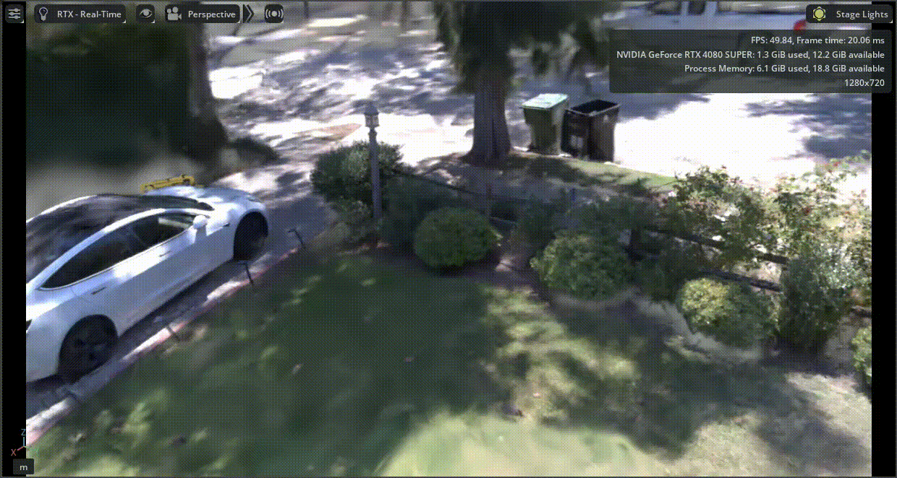

<div align="center">

<h2>Ego2Sim: Photorealistic Contact-Enabled Simulation from Egocentric Data</h2>

<a href="https://ego2sim.xyz/ego2sim.pdf"></a>
<a href="https://ego2sim.xyz"></a>
<a href="https://www.youtube.com/watch?v=d8mcdGW2FAk"></a>

Aidan Gildea, Sunwoong Choi

[Sensing and Robotics for Infrastructure (SRI) Lab](https://sri-lab.seas.ucla.edu/), University of California, Los Angeles

[Sim2Real2Field Workshop](https://sim2real2field-corl26.github.io/) at CoRL 2026

<p>
  <a href="https://www.ucla.edu"><picture><source media="(prefers-color-scheme: dark)" srcset="https://github.com/Aidan-Gildea/ego2sim/raw/main/media/ucla_logo_white.png"></picture></a>
  &nbsp;&nbsp;&nbsp;&nbsp;
  <a href="https://www.corl.org"></a>
</p>

</div>

## Overview

<p align="center"></p>

Ego2Sim turns one walk with Meta's [Project Aria Gen 2](https://www.projectaria.com/) glasses into a scene that a robot can walk through in NVIDIA Isaac Sim. Each scene has two parts:

- **A Gaussian splat for appearance**, trained on the glasses' RGB video.
- **A collision mesh for contact**, built from the glasses' own SLAM points, which come from Aria's Machine Perception Services (MPS).

Both come out in the same metric, gravity-aligned frame, so they line up with no registration step, and they are packed into one `.usdz` file. Against same-day iPad LiDAR scans, the collision mesh reaches an F-score of 0.84–0.94 at 10 cm within 1 m of the ground, and it takes 51–160× less time to build than a multi-view stereo mesh. The frame extraction and splat training come from Meta's [egocentric_splats](https://github.com/facebookresearch/egocentric_splats).

## Quick start

You need:
- **Linux with an NVIDIA GPU.** 16 GB was enough for the outdoor recordings; the indoor Room sample needed 48 GB.
- **A Python 3.10 environment with CUDA PyTorch 2.6 or newer**, plus the matching CUDA toolkit (`nvcc`). gsplat compiles its CUDA code the first time it runs.
- **[COLMAP](https://colmap.github.io/install.html) on your `PATH`**, built with CGAL. Package-manager builds include it.
- **Isaac Sim 5.1** to open the result.

```bash
git clone https://github.com/Aidan-Gildea/ego2sim.git
cd ego2sim
pip install -r requirements.txt
```

## Run on your own recording

### 1. Get the MPS output

[Machine Perception Services](https://facebookresearch.github.io/projectaria_tools/docs/ARK/mps) gives the recording's SLAM trajectory and points. `aria_mps` asks you to sign in with your Project Aria account, uploads the recording and downloads the result next to it. Install it with `pipx`, because its pinned packages clash with the training packages.

```bash
pipx install projectaria-mps
aria_mps single -i ~/recordings/Outside_20260812_141244.vrs --features SLAM
```

The pipeline looks for the output in `mps_<recording>_vrs/slam/` next to the `.vrs`. If yours is somewhere else, set `MPS_FOLDER` to its `slam/` folder. [Sample recordings](https://drive.google.com/drive/folders/1INGZFiCD6qYtHSzbXo4Qegmj-flwikv0) with their MPS output are on Google Drive.

The defaults assume recording profile `profile10` (RGB 2016×1512 at 30 Hz). For any other profile, `python debug_scripts/recording_info.py --vrs <file>` prints the `RGB_FOCAL` and `RGB_HEIGHT` to set.

### 2. Run the pipeline

```bash
bash run_contactsplat.sh ~/recordings/Outside_20260812_141244.vrs
```

A first run takes a few hours: extracting the frames and training the splat each take one to three hours, and the collision mesh takes a few minutes. If you stop and rerun it, stages that already finished are skipped. A stopped training run starts over.

| Stage | Script | What it makes |
| --- | --- | --- |
| 1.&nbsp;Frames | `scripts/bash_local/run_gen2_outside.sh` | Undistorted RGB frames, each with its camera pose from MPS |
| 2.&nbsp;Collider | `mps-mesh/run_mps_mesh.sh` | A mesh from the MPS points, simplified for collisions |
| 3.&nbsp;Splat | `scripts/bash_local/train_gen2_outside.sh` | The Gaussian splat, trained for 30,000 steps |
| 4.&nbsp;Scene | `isaacsim/splat_and_mesh_to_usdz.py` | One `.usdz` with the visible splat and the invisible collider |

```text
~/recordings/processed/<recording>/camera-rgb-rectified-1008-h1512/   1. frames
ego2sim/output/
├── mps-mesh/<recording>/camera-rgb-rectified-1008-h1512/
│   ├── mesh_delaunay_decimated.ply                                   2. collider
│   └── report_decimated.md                                           collider score
└── <recording>/camera-rgb-rectified-1008-h1512/
    ├── point_cloud/iteration_30000/point_cloud.ply                   3. splat
    ├── test_logs.json                                                splat score
    └── isaacsim/<recording>_with_collider.usdz                       4. scene
```

`report_decimated.md` checks the collider without a reference scan: how much of the walked floor it covers, its largest hole and its floor height error. `test_logs.json` scores the splat on frames held out from training.

### 3. Open it in Isaac Sim

Open the `.usdz` with File > Open and press Play to turn on collisions. The splat is what you see; the mesh is invisible and only collides.

<p align="center"></p>

<details>
<summary><b>Settings</b></summary>

Every setting is at the top of `run_contactsplat.sh`, with a note on what changing it does. Edit it there, or set it before the command, for example `ITERATIONS=15000 bash run_contactsplat.sh ...`.

| Setting | Default | Effect |
| --- | --- | --- |
| `ITERATIONS` | `30000` | Training steps. Training time grows about linearly with it |
| `CAP_MAX` | `1500000` | Most Gaussians training may grow to. Higher gives more detail, more GPU memory and slower steps |
| `ROLLING_SHUTTER`, `RS_START` | `true`, `10000` | Model the camera reading out row by row, from that step on. Sharper, but slower steps |
| `DEPTH_LOSS` | `false` | Also fit the MPS sparse depth |
| `TRAIN_SPLIT` | `7-1` | `7-1` holds out every 8th frame to score the splat. `all` trains on every frame |
| `MESH_SOURCE` | `mps` | `mvs` builds the collider with COLMAP multi-view stereo instead. That takes hours and fills outdoor floors only slightly better. Known bug: frames get the wrong poses when their timestamps change length partway through a recording |
| `DECIMATE` | `1` | `0` uses the full mesh as the collider |
| `EYE_HEIGHT` | `1.6683` | Height of the glasses above the floor in metres. Only used to score the mesh |
| `RGB_FOCAL`, `RGB_HEIGHT` | `1008`, `1512` | Rectified frame size. Change for recording profiles other than `profile10` |

A changed setting only affects stages that have not run yet. To redo the mesh, add `FORCE=1`. To retrain the splat, delete `output/<recording>/<rect>/point_cloud/`.

</details>

## Visualize the splat

To look at a trained splat on its own in a browser (port 8080):

```bash
python launch_viewer.py model_root=output/<recording>
```

## Recording tips

- Walk through the scene. Turning in place gives no depth.
- Record for 2 to 5 minutes, and pass earlier spots again so MPS can close loops.
- Turn your head slowly and avoid dim places. Indoors the camera exposure is long, so fast motion blurs the frames.

## Repository layout

| Path | What it does |
| --- | --- |
| `run_contactsplat.sh` | Runs the whole pipeline and holds every setting |
| `scripts/extract_aria_vrs.py` | Stage 1: reads the `.vrs` and the MPS output, writes rectified, posed frames |
| `mps-mesh/` | Stage 2: collision mesh from the MPS points |
| `photogrammetry/` | Mesh scoring and simplification used by stage 2, and the optional multi-view stereo mesh |
| `train_lightning.py`, `model/`, `scene/`, `conf/` | Stage 3: splat training (from egocentric_splats). Defaults for every training option are in `conf/` |
| `isaacsim/splat_and_mesh_to_usdz.py` | Stage 4: the Isaac Sim scene |
| `paper_evaluations/` | The paper's evaluation: aligns an iPad LiDAR scan to the MPS frame and scores the collider against it |
| `debug_scripts/`, `docs/` | Checks, and notes on Aria Gen 2 and rectification |

The code used for the paper is tagged [`srf-2026`](https://github.com/Aidan-Gildea/ego2sim/tree/srf-2026).

## Citation

```bibtex
@inproceedings{gildea2026ego2sim,
    title={Ego2Sim: Photorealistic Contact-Enabled Simulation from Egocentric Data},
    author={Gildea, Aidan and Choi, Sunwoong},
    booktitle={Sim2Real2Field Workshop at the Conference on Robot Learning (CoRL)},
    year={2026}
}
```

Ego2Sim builds on egocentric_splats:

```bibtex
@inproceedings{lv2025egosplats,
    title={Photoreal Scene Reconstruction from an Egocentric Device},
    author={Lv, Zhaoyang and Monge, Maurizio and Chen, Ka and Zhu, Yufeng and Goesele, Michael and Engel, Jakob and Dong, Zhao and Newcombe, Richard},
    booktitle={ACM SIGGRAPH},
    year={2025}
}
```

## License

[CC BY-NC 4.0](LICENSE), inherited from [egocentric_splats](https://github.com/facebookresearch/egocentric_splats). Ego2Sim also builds on:

* [COLMAP](https://colmap.github.io/) for meshing, BSD
* [gsplat](https://github.com/nerfstudio-project/gsplat) for splat training, Apache 2.0
* [Project Aria Tools](https://github.com/facebookresearch/projectaria_tools) for reading Aria recordings, Apache 2.0
* [3dgrut](https://github.com/nv-tlabs/3dgrut), whose USDZ writer is adapted here, Apache 2.0
