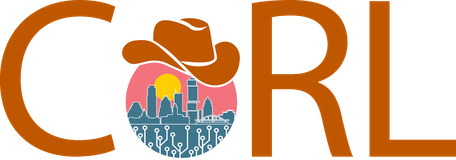
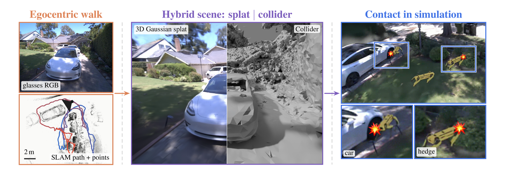
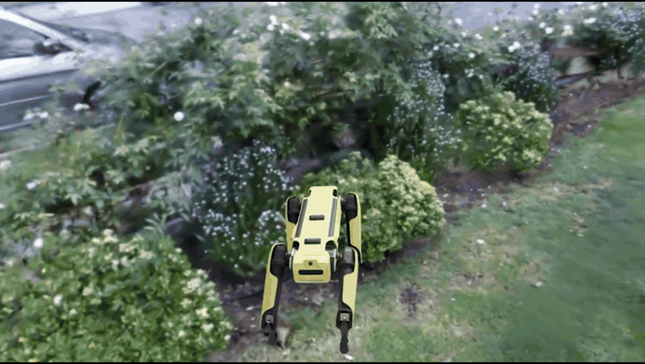

<h2 align="center">
  Ego2Sim: Photorealistic Contact-Enabled Simulation from Egocentric Data
  <br>
  <sub>Aidan Gildea, Sunwoong Choi</sub>
</h2>

<div align="center">

<a href="https://ego2sim.xyz/ego2sim.pdf"></a>
<a href="https://www.alphaxiv.org/abs/2611.ego2sim-egocentric-contact-simulation"></a>
<a href="https://ego2sim.xyz"></a>
<a href="https://www.youtube.com/watch?v=d8mcdGW2FAk"></a>
<a href="https://sri-lab.seas.ucla.edu/"></a>
<a href="https://sim2real2field-corl26.github.io/"></a>

<p>
  <a href="https://www.ucla.edu"><picture><source media="(prefers-color-scheme: dark)" srcset="https://github.com/Aidan-Gildea/ego2sim/raw/main/media/ucla_logo_white.png"></picture></a>
  &nbsp;&nbsp;&nbsp;&nbsp;
  <a href="https://www.corl.org"></a>
</p>

</div>

<p align="center"></p>

<p align="center">This repository is the code for the Ego2Sim paper.</p>

## Quick Start

System requirements:
- **Linux with an NVIDIA GPU.** 16+ GB VRAM recommended
- **Python 3.10 with CUDA PyTorch 2.6 or newer**, plus the CUDA toolkit (`nvcc`) of the same CUDA version
- **[COLMAP](https://colmap.github.io/install.html) on your `PATH`**, built with CGAL
- **Isaac Sim 5.1** to open the result

```bash
# Clone the repository
git clone https://github.com/Aidan-Gildea/ego2sim.git
cd ego2sim

# Install PyTorch for your CUDA version (12.8 here), then the dependencies
pip install torch torchvision --index-url https://download.pytorch.org/whl/cu128
pip install -r requirements.txt

# Install COLMAP and the Aria MPS tool
sudo apt install colmap
pipx install projectaria-mps

# Get the SLAM output for your recording (it is saved next to the .vrs)
aria_mps single -i ~/recordings/<recording>.vrs --features SLAM

# Run the pipeline
bash run_ego2sim.sh ~/recordings/<recording>.vrs
```

A first run takes a few hours. If you run it again, the stages that finished are skipped.

The defaults fit recording profile `profile10` (RGB 2016×1512 at 30 Hz). For other profiles, see [tools](tools/README.md#other-recording-profiles).

## Repository Structure

```
ego2sim/
├── run_ego2sim.sh        # Runs the whole pipeline
├── frames/               # 1. Extract posed frames from the recording
├── mesh/                 # 2. Build the collision mesh
│   ├── mps-mesh/         #    from the glasses' SLAM points (default)
│   └── photogrammetry/   #    from multi-view stereo (baseline)
├── splat/                # 3. Train the Gaussian splat
│   └── conf/             #    training parameters
├── isaacsim/             # 4. Pack the splat and the mesh into one USDZ
├── tools/                # Not part of the pipeline
│   ├── debug/            #    checks for your recording and setup
│   └── eval/             #    the paper's evaluation
└── media/                # Images for this README
```

The training parameters and where to set them are in [splat/README.md](splat/README.md). The mesh and scene settings are at the top of `run_ego2sim.sh`.

The code used for the paper is tagged [`srf-2026`](https://github.com/Aidan-Gildea/ego2sim/tree/srf-2026).

## Output and Training Data

- **Training data.** Sample recordings with their MPS output are on [Google Drive](https://drive.google.com/drive/folders/1INGZFiCD6qYtHSzbXo4Qegmj-flwikv0). The frames the splat trains on are written to `<recordings>/processed/<recording>/`.
- **Final scene.** The USDZ is at `output/<recording>/camera-rgb-rectified-1008-h1512/isaacsim/<recording>_with_collider.usdz`. Open it in Isaac Sim with File > Open and press Play to turn on collisions.

<p align="center"></p>

## Citation

```bibtex
@inproceedings{gildea2026ego2sim,
    title={Ego2Sim: Photorealistic Contact-Enabled Simulation from Egocentric Data},
    author={Gildea, Aidan and Choi, Sunwoong},
    booktitle={Sim2Real2Field Workshop at the Conference on Robot Learning (CoRL)},
    year={2026}
}
```

## License

[CC BY-NC 4.0](LICENSE), inherited from Meta's [egocentric_splats](https://github.com/facebookresearch/egocentric_splats), which the frame extraction and splat training come from. Ego2Sim also builds on [COLMAP](https://colmap.github.io/), [gsplat](https://github.com/nerfstudio-project/gsplat), [Project Aria Tools](https://github.com/facebookresearch/projectaria_tools) and [3dgrut](https://github.com/nv-tlabs/3dgrut).
